<p align="center"></p>

# Vanishly

Share passwords and other secrets with a link that works only once.
Vanishly encrypts the secret **in your browser**, stores only the ciphertext
in Redis and deletes it after it was viewed, burned or expired. The key is
part of the link after `#`, which browsers never send to the server, so not
even the server operator can read a secret.

Vanishly runs as a small Node.js container next to Redis.

## Features

- **End-to-end encrypted:** AES-256-GCM in the browser (Web Crypto), random
  256-bit key per secret, only in the link fragment.
- **Burn after reading**, or a set number of views (1 to `MAX_VIEWS`), and
  an expiry from 5 minutes to `MAX_TTL`.
- **Optional passphrase:** checked by the server before the secret is handed
  out; a wrong one does not use a view, too many destroy the secret.
- **Receipt link for the sender:** status, view times (no IPs), copy the
  share link again, burn the secret early.
- **Only for chosen people (optional):** with sign-in via Microsoft Entra
  ID, Keycloak, Okta, Auth0, Google Workspace, PingOne, JumpCloud, Cognito or
  any OpenID Connect provider (`AUTH_PROVIDER`), the sender names the
  people or groups who may open a secret (with a directory also by
  searching names in a group). The server hands it out only to
  them after they signed in; others use no view. Off by default; a test
  login server for trying it is included.
- **Click to reveal:** opening the link shows nothing yet, so chat and mail
  link previews cannot burn a secret.
- **Password generator** (in the browser, `crypto.getRandomValues`), with
  configurable length and character classes.
- **OpenAPI 3.1 API** (`/api/openapi.json`, API reference at `/api/docs`,
  linked in the footer), including `POST /api/v1/share` and
  `POST /api/v1/open` (open a link with its passphrase) for scripts and
  `curl`; or switch the public API off.
- **Templates for your branding:** logo, favicon, colours, fonts, pictures,
  footer links, texts and, if you like, own HTML views. Two designs are
  built in, each with light and dark mode and made for phones: `default`
  (blue) and `aurora` (bright white with soft violet/teal accents, round),
  plus `example-brand` as a starting point for your own. `TEMPLATE` picks
  the design, `DEFAULT_MODE` whether it starts light, dark or like the
  visitor's system.
- **Switch off what you do not need:** passphrase, views, receipts, burn,
  view log, generator, language and light/dark buttons, the API, its docs
  and its footer link, the GitHub link (`ENABLE_*`).
- **Configured with environment variables only:** all of them with their
  defaults in `docker-compose.yml` and `.env.example`; a wrong value or a
  misspelt name stops the start with a clear message.
- **Rules for your organisation (optional):** minimum secret length,
  required passphrase with minimum length and character classes, a
  confirmation checkbox with your own text ("only one password, no user
  name..."), and the expiry choices of the form.
- **Mobile friendly and accessible:** WCAG 2.2 AA (BITV 2.0) as the target,
  every page checked automatically with axe-core in all templates, light and
  dark, down to 320 px; keyboard and screen reader support. English and German.
- **Hardened:** both containers run without root, read-only, without
  capabilities; CI runs npm audit, CodeQL and Trivy (repository, Dockerfile,
  images).
- **Privacy:** no cookies except the language choice (and the session when
  sign-in is on), no IPs stored, no
  third-party requests, strict Content Security Policy, `no-store` caching.

How a secret is protected, step by step and with its limits:
[docs/SECURITY.md](docs/SECURITY.md).

## Screenshots

**Create a secret (light)**

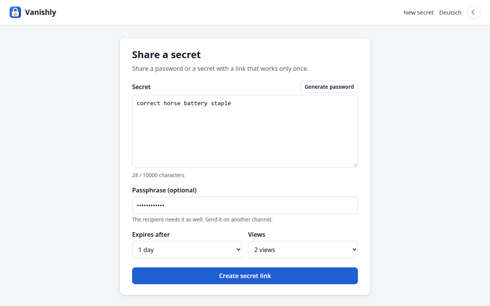

**Link ready (dark)**

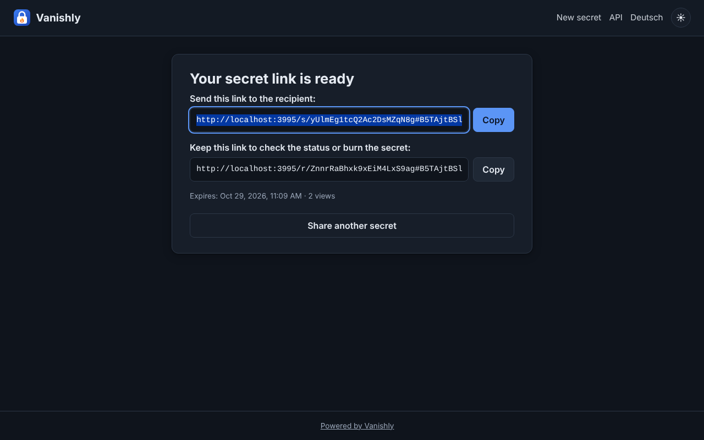

**Receipt for the sender**

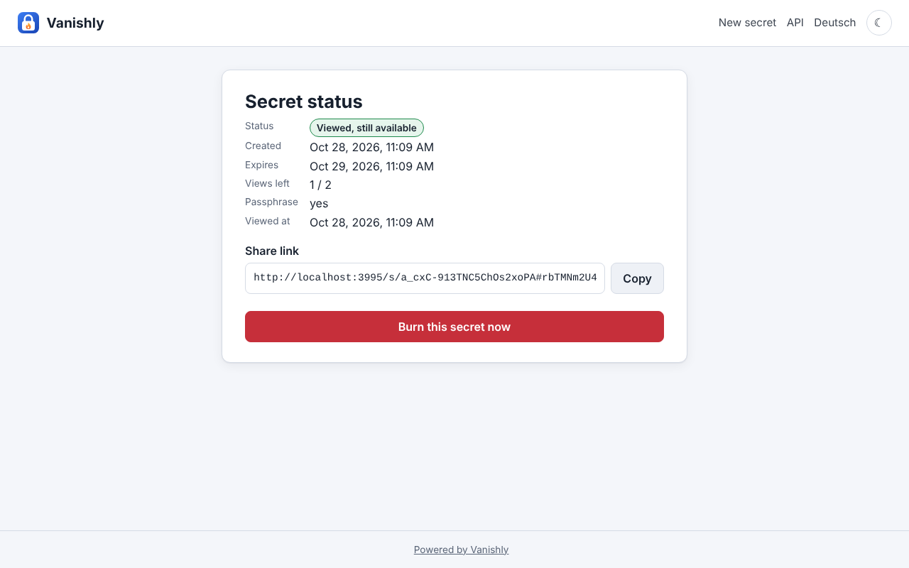

**Recipient on a phone: passphrase, then the secret**

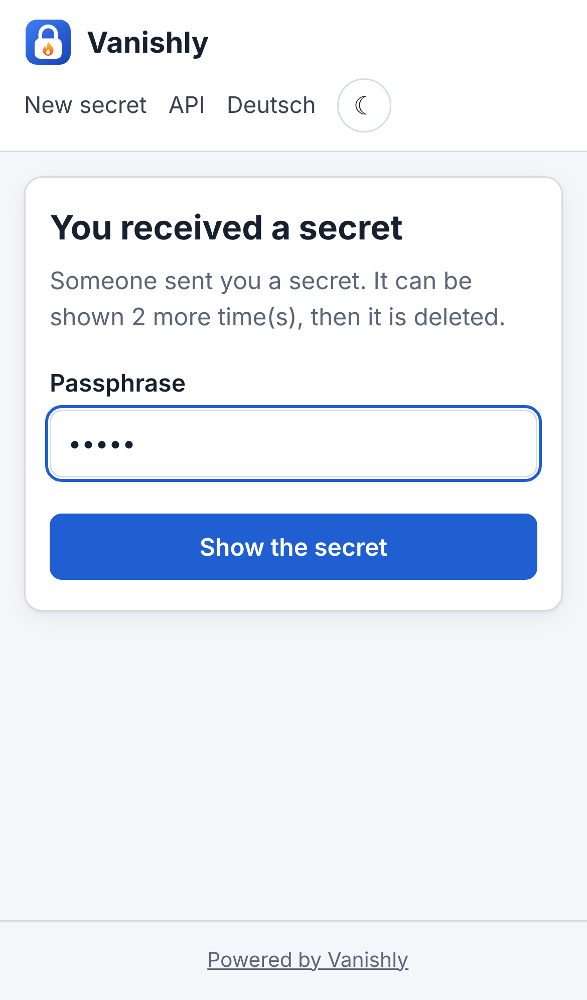 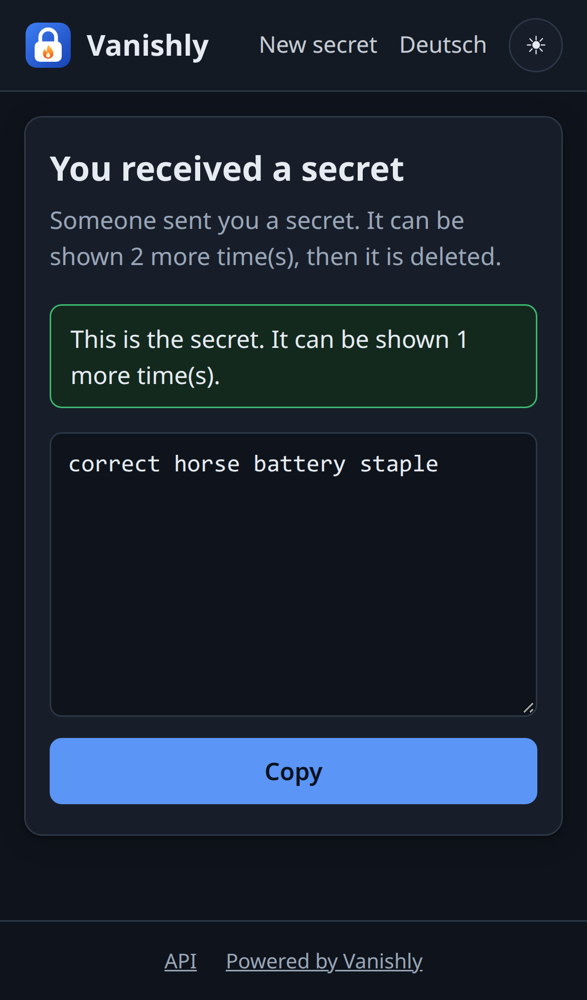

**Optional rules: passphrase complexity, confirmation, own expiry choices (German, phone)**

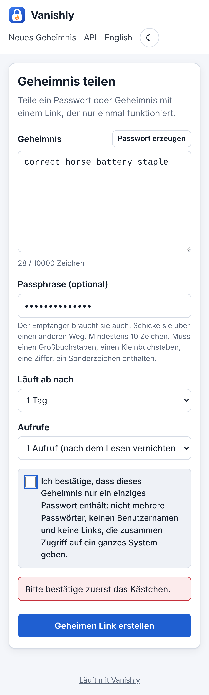

**Built-in design `aurora` (`TEMPLATE=aurora`): light, dark, phone**

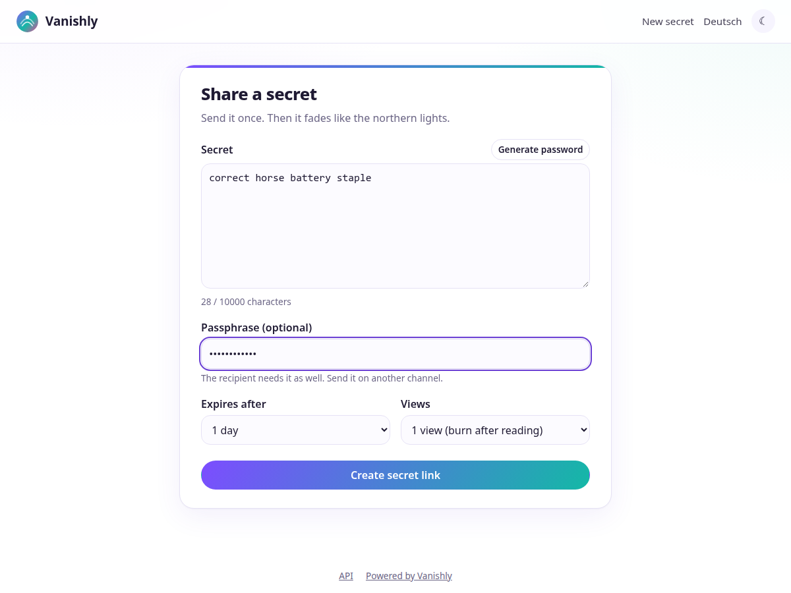

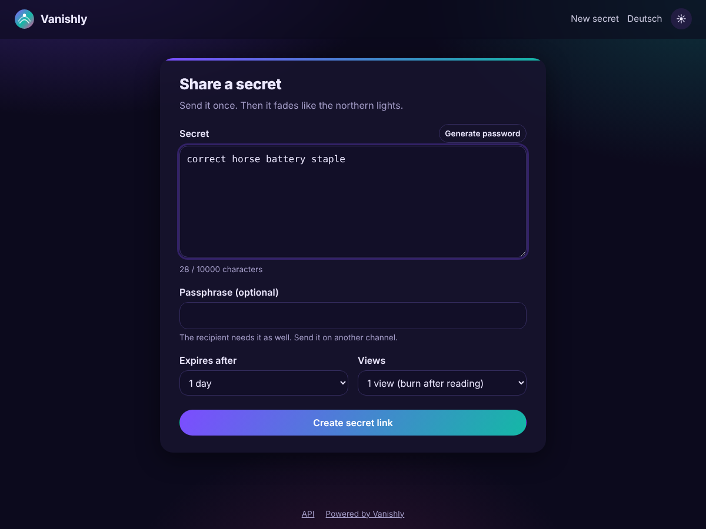 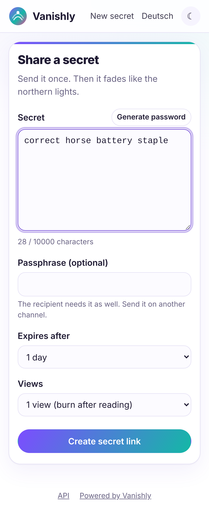 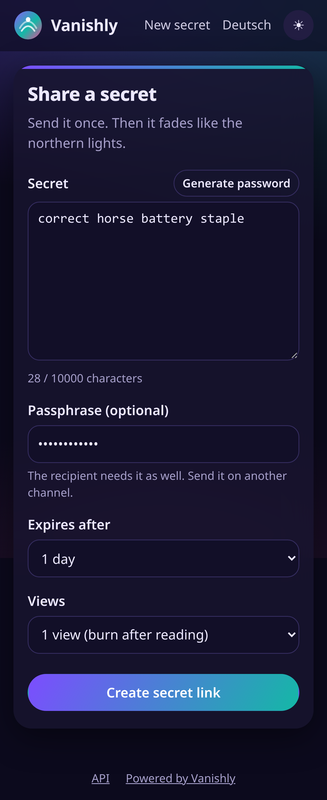

**API documentation (`/api/docs`)**

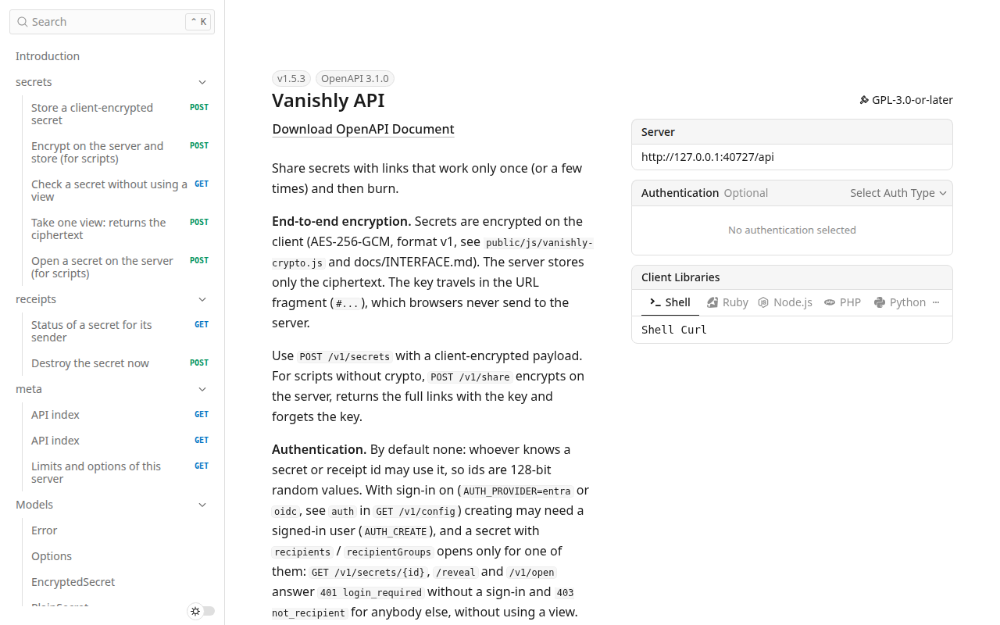

## Requirements

- Docker with Docker Compose (the image brings Node.js 24 LTS on Alpine
  Linux), or Node.js 22 or newer
- Redis 7 or newer (included in `docker-compose.yml` and in the Helm chart)
- Or Kubernetes 1.25 or newer with Helm: [charts/vanishly](charts/vanishly/README.md)
- A reverse proxy with TLS (nginx, Caddy, Traefik) in front of port 3000

## Quick start

```bash
curl -fsSLO https://raw.githubusercontent.com/DennisPohlmann/Vanishly/main/docker-compose.yml
curl -fsSL https://raw.githubusercontent.com/DennisPohlmann/Vanishly/main/.env.example -o .env
# edit .env: BASE_URL, TRUST_PROXY=1 behind a proxy
docker compose up -d          # or: podman-compose up -d
```

`docker-compose.yml` pulls the published image, so it needs nothing else
from the repository. To build from a checkout instead:
`docker compose -f docker-compose.yml -f docker-compose.build.yml up -d --build`.

Then open `http://127.0.0.1:3000`. Every setting is listed with its default
in `docker-compose.yml`; change it there or in `.env`, e.g.
`TEMPLATE=aurora`, `REQUIRE_PASSPHRASE=true`, `ENABLE_RECEIPTS=false`.
The full list: [docs/CONFIG.md](docs/CONFIG.md). Every step, the reverse proxy and the
tar.gz with systemd: [docs/INSTALLATION.md](docs/INSTALLATION.md).

On Kubernetes, with the bundled Redis (all values: [charts/vanishly](charts/vanishly/README.md)):

```bash
helm install vanishly oci://ghcr.io/dennispohlmann/charts/vanishly \
  --namespace vanishly --create-namespace --set config.BASE_URL=https://ots.example.com
```

```bash
# Share from the command line
curl -s -X POST http://127.0.0.1:3000/api/v1/share \
  -H 'Content-Type: application/json' \
  -d '{"secret":"correct horse battery staple","ttl":3600,"views":1}'
```

## Documentation

| File | Content |
|------|---------|
| [docs/INSTALLATION.md](docs/INSTALLATION.md) | docker compose, container, tar.gz with systemd, Kubernetes (Helm), reverse proxy, update, troubleshooting, removal |
| [docs/CONFIG.md](docs/CONFIG.md) | all environment variables, Redis, rate limits, languages |
| [docs/USAGE.md](docs/USAGE.md) | pages, how sharing works, receipts, health and monitoring |
| [docs/SECURITY.md](docs/SECURITY.md) | how a secret is protected: encryption in the browser, what Redis stores, passphrase, behaviour on Redis errors, limits |
| [docs/providers/](docs/providers/README.md) | sign-in providers: what each supports, setup per provider |
| [docs/INTERFACE.md](docs/INTERFACE.md) | REST API (OpenAPI), crypto format, Redis keys |
| [docs/DEVELOPMENT.md](docs/DEVELOPMENT.md) | local development, tests, CI and releases |
| [templates/README.md](templates/README.md) | own templates: logo, CSS, pictures, views |
| [charts/vanishly/README.md](charts/vanishly/README.md) | Helm chart: install from ghcr.io, all values, Redis, own templates, overrides |
| [openapi/openapi.json](openapi/openapi.json) | the API contract |
| [CHANGELOG.md](CHANGELOG.md) | changes per version |
| [THIRD-PARTY-LICENSES.md](THIRD-PARTY-LICENSES.md) | third-party components and their licenses |

## Building

```bash
make check      # npm ci, type check, tests (needs Redis)
make package    # dist/vanishly-<version>.tar.gz + .sha256
make image      # local Docker image vanishly:<version>
make up         # build from this folder and start with Compose
```

Local development and the release process: [docs/DEVELOPMENT.md](docs/DEVELOPMENT.md).

## License

Vanishly is free software under the GNU General Public License, version 3 or
(at your option) any later version. The full text is in [LICENSE](LICENSE). The third-party packages and their licenses are
listed in [THIRD-PARTY-LICENSES.md](THIRD-PARTY-LICENSES.md).
